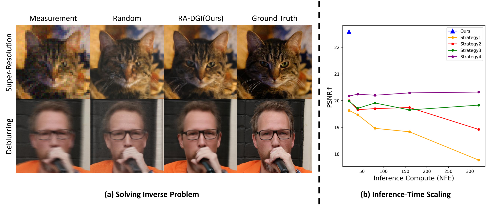

# [WACV 2027] Retrieval-Augmented Initialization with Dual-Guided Inversion for Flow-Based Inverse Problem Solvers

[](https://arxiv.org/abs/2610.41695)

> **Retrieval-Augmented Initialization with Dual-Guided Inversion for Flow-Based Inverse Problem Solvers**<br>
> Hansam Cho, Seoung Bum Kim<br>
>
> **Abstract**: <br>
Flow models have recently emerged as powerful generative priors for solving inverse problems. Despite their success, most existing flow-based inverse problem solvers initialize the reconstruction process with random Gaussian noise. However, recent studies in image generation have shown that the choice of initial noise can significantly influence generation outcomes. The role of initialization as a distinct design choice in flow-based inverse problem solving remains comparatively underexplored. In this work, we systematically evaluate noise initialization strategies while holding the downstream flow-based inverse solver fixed. We propose Retrieval-Augmented Initialization with Dual-Guided Inversion (RA-DGI), a method that constructs improved initial noise by leveraging retrieved proxy clean images and dual-guided inversion. Extensive experiments across multiple inverse problems demonstrate that the quality of the initial noise substantially affects reconstruction fidelity and perceptual performance. RA-DGI outperforms standard random initialization and achieves superior results compared to inference-time scaling strategies, while requiring less computational overhead. These findings highlight initialization as a critical yet previously overlooked factor in flow-based inverse solvers.

## Description

Official implementation of **Retrieval-Augmented Initialization with Dual-Guided Inversion for Flow-Based Inverse Problem Solvers (WACV 2027)**.

This repository is based on the official [FlowDPS](https://github.com/FlowDPS-Inverse/FlowDPS) code. RA-DGI retrieves a proxy clean image using measurement-space DINOv3 features, constructs initial noise through dual-guided inversion, and reconstructs the image with FlowDPS and Stable Diffusion 3 Medium.



## Setup

Use Python 3.10–3.12 and a CUDA GPU.

```bash
git clone https://github.com/hansam95/RA-DGI.git
cd RA-DGI
conda create -n ra-dgi python=3.10 -y
conda activate ra-dgi
# CUDA 12.8 example; choose the PyTorch index appropriate for your system.
pip install torch==2.7.0 torchvision==0.22.0 --index-url https://download.pytorch.org/whl/cu128
pip install -r requirements.txt
```

Access to [Stable Diffusion 3 Medium](https://huggingface.co/stabilityai/stable-diffusion-3-medium-diffusers) and [DINOv3 ViT-S/16](https://huggingface.co/facebook/dinov3-vits16-pretrain-lvd1689m) is required.

## RA-DGI + Inverse Problems

The following examples use the included cat image and three retrieval images:

```text
samples/
  input/flickr_cat_000008.jpg
  retrieval/
    0.jpg
    1.jpg
    10.jpg
```

For experiments, replace the sample paths with your own images and retrieval pool.

### Super-resolution

16x average-pool downsampling with measurement noise of 0.05.

```bash
python solve.py --img_path samples/input --prompt "a photo of a close-up face of a cat" \
  --db_img_dir samples/retrieval --task sr_avgpool --deg_scale 16 \
  --measurement_noise 0.05 --efficient_memory
```

### Motion deblurring

Motion blur with an 81x81 kernel and measurement noise of 0.05.

```bash
python solve.py --img_path samples/input --prompt "a photo of a close-up face of a cat" \
  --db_img_dir samples/retrieval --task deblur_motion --deg_scale 81 \
  --measurement_noise 0.05 --efficient_memory
```

### Denoising

Additive Gaussian noise with a standard deviation of 0.7.

```bash
python solve.py --img_path samples/input --prompt "a photo of a close-up face of a cat" \
  --db_img_dir samples/retrieval --task denoising --deg_scale 0.7 \
  --efficient_memory
```

### Block compressive sensing

32x32 blocks with a measurement ratio of 0.1 and measurement noise of 0.05.

```bash
python solve.py --img_path samples/input --prompt "a photo of a close-up face of a cat" \
  --db_img_dir samples/retrieval --task cs_blockbased --deg_scale 0.1 \
  --measurement_noise 0.05 --efficient_memory
```

All examples use 10 reconstruction steps, 10 inversion steps, image size 768, and CFG 2.

Use `--img_path` for the input images and `--db_img_dir` for the clean retrieval images. Use `--prompt` for a shared prompt or `--prompt_file` for one prompt per image.

<details>
<summary>Arguments</summary>

| Argument | Default | Meaning |
| --- | --- | --- |
| `--img_size` | 768 | Image size |
| `--NFE` | 10 | Reconstruction steps |
| `--NFE_inv` | 10 | Inversion steps |
| `--cfg_scale` | 2.0 | Guidance scale |
| `--step_size` / `--step_size_inv` | 15.0 / 15.0 | Measurement guidance step sizes |
| `--db_size` | 1000 | Retrieval pool size, capped at available images |
| `--db_dir` | `db` | Retrieval cache directory |
| `--num_samples` | -1 | Number of inputs; -1 uses all images |
| `--seed` | 0 | Random seed |
| `--deg_scale` | Per task | 16, 81, 0.7, or 0.1 for the tasks above |
| `--measurement_noise` | Per task | `deg_scale` for denoising, otherwise 0.05 |

</details>

<details>
<summary>Outputs and retrieval DB</summary>

```text
results/sr_avgpool_16.0/
  input/0000.png
  recon/0000.png
  label/0000.png
  retrieval/0000.png
  config.json
  retrieval.json
```

`input`, `recon`, `label`, and `retrieval` contain the degraded input, reconstruction, clean target, and retrieved image, respectively.

A separate retrieval DB is built for each degradation:

```text
db/
  sr_avgpool_16_noise_0.05/
  deblur_motion_81_noise_0.05/
  denoising_0.7_noise_0.7/
  cs_blockbased_0.1_noise_0.05/
```

Each folder contains `index.faiss` and `meta.json`. Matching degradation and feature-generation settings reuse the existing DB; changed settings rebuild it.

</details>

## Acknowledgements

This repository is built upon the official [FlowDPS](https://github.com/FlowDPS-Inverse/FlowDPS) implementation. We also thank [Diffusers](https://github.com/huggingface/diffusers), [Transformers](https://github.com/huggingface/transformers), [DINOv3](https://github.com/facebookresearch/dinov3), [FAISS](https://github.com/facebookresearch/faiss), and [motionblur](https://github.com/LeviBorodenko/motionblur) for their open-source contributions.

## Citation

```bibtex
@article{cho2026radgi,
  title={Retrieval-Augmented Initialization with Dual-Guided Inversion for Flow-Based Inverse Problem Solvers},
  author={Cho, Hansam and Kim, Seoung Bum},
  journal={arXiv preprint arXiv:2610.41695},
  year={2026}
}
```
